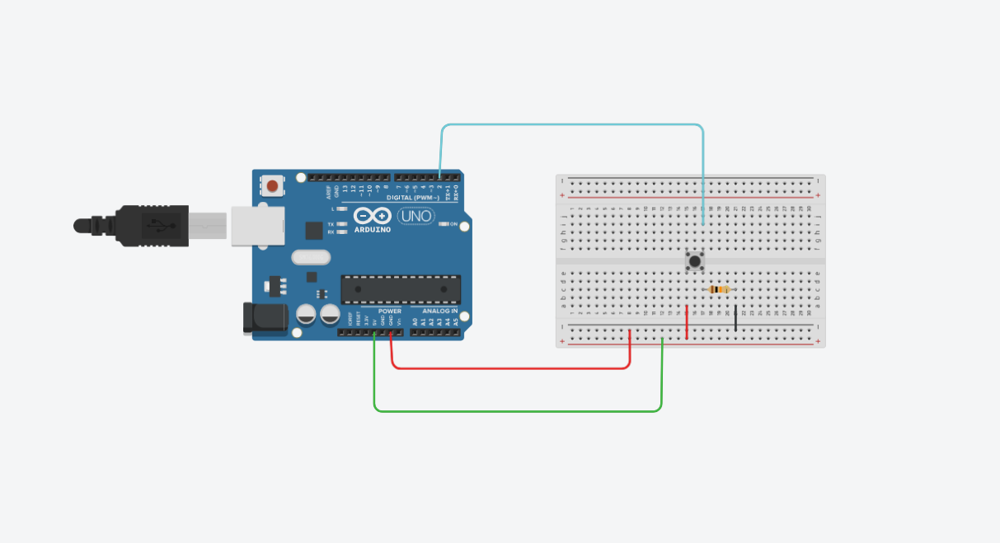
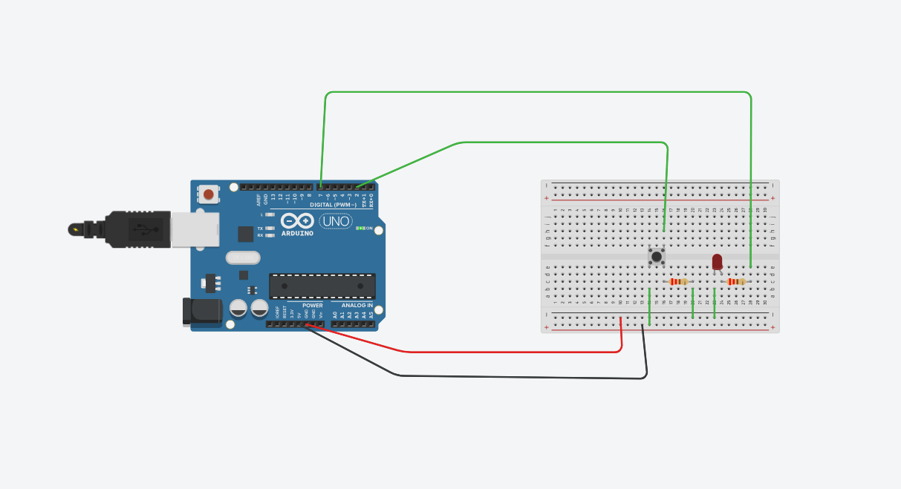
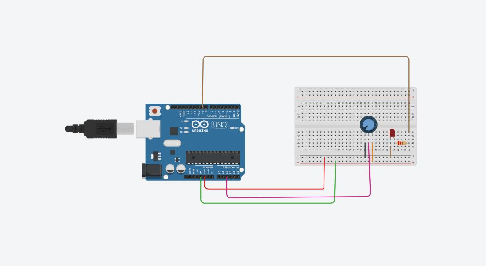

# Lab #2 (2026.11.15) — 버튼 입력, ADC·PWM, 부저, 서보모터 제어

## 1. 개요
Tinkercad(Arduino Uno)에서 버튼 입력과 ADC→PWM 변환을 실습하고,
실제 ESP32 보드로 부저와 서보모터를 PWM으로 제어했다.

## 2. 이론적 배경
로봇 코딩에서는 0과 1로만 코딩을 한다 그래서 매우 힘들다.

band rate = bits

pwm (pulse width modulator)

duty cycle = 50%

## 3. 핵심 기술
- **디지털 입력**: 외부 풀다운 저항으로 버튼 상태를 HIGH/LOW로 판별
- **ADC → PWM 매핑**: `map()`으로 ADC 범위(Uno 0~1023 / ESP32 0~4095)를 PWM(0~255) 또는 각도(0~180°)로 변환
- **ESP32 LEDC PWM**: `ledcAttach()` / `ledcWrite()`로 주파수·분해능을 지정해 부저 출력
- **서보 제어**: `ESP32Servo` 라이브러리로 각도 지정, for 루프로 1°씩 이동해 부드러운 회전 구현


## 5. 결과 및 분석
| 실습 | 회로 |
|---|---|
| 버튼 입력 |  |
| 버튼 → LED |  |
| 가변저항 → LED 밝기 |  |

<!-- 결과 / 잘 안 된 점과 원인 / 보완할 점 (예: 시리얼 baud rate 불일치로 문자 깨짐, ESP32 업로드 오류 exit status 2 등) -->

## 6. 파일 구조
```
261115/
├── README.md
├── buttonPincode.txt   # [Uno] 버튼 상태를 시리얼로 출력 (D2)
├── buttonPin.png
├── buttonled.txt       # [Uno] 버튼을 누르면 LED 점등 (버튼 D2, LED D7)
├── buttonled.png
├── ADC.txt             # [Uno] 가변저항 값으로 LED 밝기 제어 (A2 → D9 PWM)
├── ADC.png
├── BUZZER.txt          # [ESP32] LEDC PWM 듀티로 부저 음량 단계 변화 (GPIO5)
├── basicservo.txt      # [ESP32] 서보 0° ↔ 180° 1초 간격 이동 (GPIO14)
├── Servo.txt           # [ESP32] 서보 0° → 180° → 0° 부드러운 스윕 (GPIO14)
└── ServoADC.txt        # [ESP32] 가변저항 각도로 서보 제어 (POT GPIO39, SERVO GPIO14)
```

## 7. 실행 방법
### 의존성
| 대상 | 필요 항목 |
|---|---|
| `[Uno]` 파일 | Tinkercad Circuits (웹) 또는 Arduino IDE 2.x, 추가 라이브러리 없음 |
| `[ESP32]` 파일 | Arduino IDE 2.x + **esp32 by Espressif 보드 패키지 3.x 이상** (`ledcAttach` API 사용) |
| 서보 파일 | **ESP32Servo** 라이브러리 (Library Manager에서 설치) |

### 배선
| 파일 | 연결 |
|---|---|
| `buttonPincode.txt` | 버튼 한쪽 5V, 반대쪽 D2 + 10kΩ 풀다운 → GND |
| `buttonled.txt` | 버튼 D2 (풀다운 회로 동일), D7 → 220Ω → LED → GND |
| `ADC.txt` | 가변저항 양끝 5V/GND, 가운데 A2 / D9 → 220Ω → LED → GND |
| `BUZZER.txt` | 부저 + → GPIO5, − → GND |
| 서보 파일 | 서보 신호(주황) GPIO14, 전원(빨강) 5V, GND(갈색) GND |
| `ServoADC.txt` | 추가로 가변저항 양끝 **3.3V**/GND, 가운데 GPIO39 |

### 실행
1. **Tinkercad**: 회로 구성 → Code 탭(Text) → 코드 붙여넣기 → Start Simulation
2. **ESP32**: Arduino IDE에서 코드 붙여넣기 → Tools → Board: `ESP32 Dev Module`, Port 선택 → Upload
   - `Connecting...`에서 멈추면 BOOT 버튼을 누른 채 업로드
3. 시리얼 출력이 있는 파일은 Serial Monitor를 **115200 baud**로 설정
