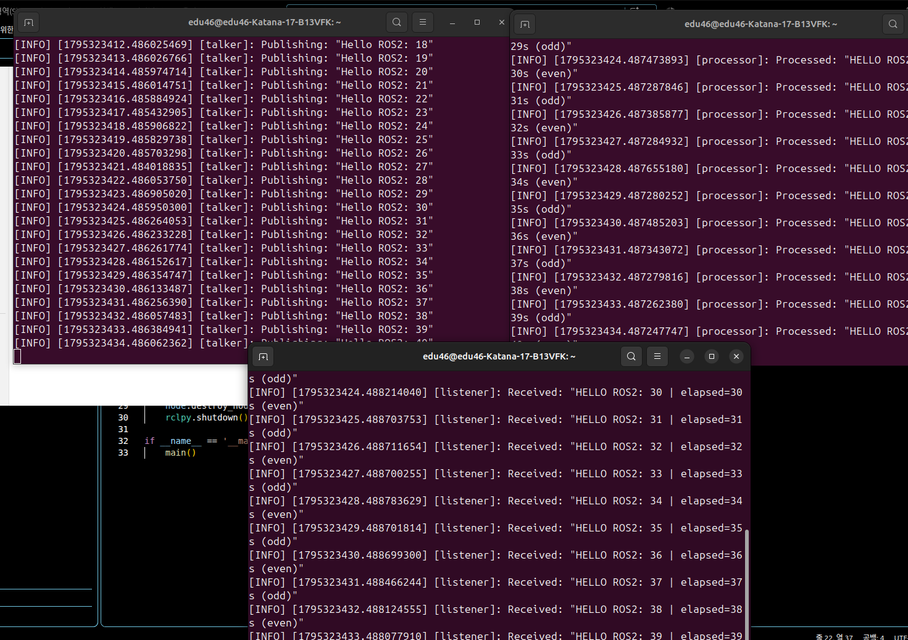

# 2026.11.22 — ROS2 노드 체이닝, Launch 파일, 서비스와 커스텀 인터페이스

## 1. 개요
Publisher → Processor → Subscriber 3개 노드를 토픽으로 연결해 데이터를 중간 가공하는 구조를 실습하고,
여러 노드를 한 번에 실행하는 **Launch 파일**을 배웠다.
이후 요청–응답 방식의 **서비스**를 직접 정의한 **커스텀 인터페이스**(`custom_interfaces`)로 구현했다.
(`AddTwoInts`: 두 정수 덧셈, `MoveRobot`: 현재 위치와 이동 거리로 다음 위치 계산)

## 2. 이론적 배경
> Node, Topic, Publisher/Subscriber, Timer, Callback 기본 개념은 261121 참고

### 2.1 노드 체이닝 (Publisher → Processor → Subscriber)
- 노드를 **기능별로 나누고 토픽으로 연결**하는 것이 ROS2의 기본 설계 방식이다.
  - Publisher: 입력만 받아 그대로 발행 (예: 키보드 `w/a/s/d`)
  - Processor: 받은 데이터를 **연산·가공**해서 다른 토픽으로 다시 발행 (예: (0,0)에서 시작해 위치 계산)
  - Subscriber: 결과를 받아 출력만 담당
- Processor는 **Subscriber와 Publisher를 한 노드(클래스 하나) 안에 함께** 가진다.
  `__init__` 하나에서 `create_subscription` 과 `create_publisher` 를 모두 만들고, **구독 콜백 안에서 publish** 한다.
- 발행 시점은 두 가지 방식이 있다.
  - **Timer 기반**: 일정 주기마다 발행 (talker)
  - **Event 기반**: 메시지를 받는 순간(콜백 호출 시) 발행 (processor)
- 토픽은 **이름으로만 연결**된다. 새 노드가 다른 토픽을 발행해도, 기존 Subscriber는 구독 중인 토픽 이름이 바뀌지 않는 한 받지 않는다.

### 2.2 메시지 객체와 타입 선택
- `std_msgs.msg.String` 은 ROS가 미리 정의한 **클래스**다. `String()` 처럼 괄호로 호출해 **객체를 생성(초기화)** 한 뒤, 내부 변수 `msg.data` 에 값을 넣어 publish 한다.
  파이썬 문자열을 그대로 publish 하면 ROS 메시지가 아니므로 동작하지 않는다.
- 여러 값을 한 번에 보낼 때는 배열형 메시지(예: `std_msgs/Int32MultiArray`, `data = [x, y]`)나 `geometry_msgs/Point` 를 쓴다.
- 사용 가능한 메시지 타입은 ROS2 공식 문서(`std_msgs`, `geometry_msgs` 등)에서 확인한다.

### 2.3 키보드 입력과 루프 구조
- `input()` 은 사용자가 입력할 때까지 **프로그램을 멈추는(blocking)** 함수다.
- 입력값 예외 처리: `.lower()` 로 대소문자 통일, `w/a/s/d` 이외 입력은 무시
- 입력을 받는 Publisher는 두 가지로 구현할 수 있다.
  - **Timer 콜백** 안에서 `input()` 후 publish
  - **while 루프**: `while rclpy.ok():` 안에서 `input()` → publish → `rclpy.spin_once(node)` (ROS1과 비슷한 방식)
- `rclpy.spin()` 은 콜백을 **계속** 처리하며 멈춰 있고, `spin_once()` 는 **한 번만** 처리하고 돌아온다.

### 2.4 Launch 파일
- 여러 노드를 터미널마다 `ros2 run` 하는 번거로움을 줄이기 위해, **명령 한 줄로 여러 노드를 순서대로 실행**하는 파일
- 위치: `src/<패키지>/launch/` 폴더, 파일명은 `이름.launch.py`
  - 실제로는 **파이썬 파일**이다. (XML도 가능하지만 조건문 등 복잡한 로직은 파이썬이 유리)
  - `.launch` 를 붙이는 이유: ROS1의 `.launch` 확장자 계승 + 일반 파이썬 소스와 구분
- 구조
  - 함수 이름 **`generate_launch_description()` 은 고정** (ROS2가 이 이름을 찾아 실행)
  - `LaunchDescription([...])` 리스트에 실행할 항목을 넣어 반환
  - `ExecuteProcess` 로 `bash` 에서 `ros2 run <패키지> <실행이름>` 명령 실행
  - `RegisterEventHandler` + `OnProcessStart`: **A가 시작된 뒤 B 실행** 처럼 실행 순서 지정
- `setup.py` 의 `data_files` 에 등록해야 빌드 시 설치 폴더로 복사된다.
  `('share/' + package_name + '/launch', ['launch/이름.launch.py'])` → (복사할 위치, [복사할 파일 목록]) 튜플
- 실행: `ros2 launch <패키지> <이름>.launch.py`

### 2.5 서비스 (Service)
- **요청(Request) → 응답(Response)** 의 일회성 양방향 통신. 퀵서비스처럼 요청하면 바로 처리해서 돌려준다.
  (예: turtlesim의 `reset`, `kill`, `spawn`)
- **Server** 노드가 서비스를 먼저 준비해 두고, **Client** 노드가 요청한다.
  - Client는 `wait_for_service()` 로 서버가 뜰 때까지 기다리고, `call_async()` → `spin_until_future_complete()` 로 응답을 기다린다.
- `.srv` 파일 = 서비스의 **메뉴판**. `---` 위는 Request, 아래는 Response
- 활용: 센서 값·위치 조회, 특정 값 초기화, MCU 대신 무거운 연산을 ROS 쪽에 맡기기 등

| 구분 | Topic | Service | Action |
|---|---|---|---|
| 방향 | 일방향 (계속 발행) | 요청 → 응답 1회 | 목표 → 피드백(여러 번) → 결과 |
| 대기 | 없음 | 응답까지 기다림 | 오래 걸리는 작업 |
| 취소 | – | 불가 | **가능** (cancel) |
| 예 | 센서 스트림 | 위치 조회, 리셋 | "문까지 이동해" (자율주행) |
| 정의 파일 | `.msg` | `.srv` | `.action` |

### 2.6 커스텀 인터페이스
- 기본 타입(`String`, `Int16` 등) 대신 **프로젝트에 맞는 메시지·서비스를 직접 정의**
- 한 번 만들어 두면 **여러 패키지에서 재사용** 가능
- 인터페이스 패키지는 Python이 아닌 **`ament_cmake` 패키지**로 만들고
  `CMakeLists.txt` 의 `rosidl_generate_interfaces()` 에 `.msg`, `.srv` 파일을 등록한다.
- 메시지 안에 다른 메시지를 필드로 넣을 수 있다 (예: `MoveRobot.srv` 안의 `RobotPose`)
  → 코드에서는 `request.current_pose.x` 처럼 한 단계 더 들어가 접근
- 필드 타입은 ROS2 IDL 타입을 써야 한다 (`float` ✗ → `float64` ✓), 필드 이름에 띄어쓰기 불가
- 사용하는 쪽 패키지의 `package.xml` 에 `<depend>custom_interfaces</depend>` 추가

### 2.7 작업 위치 규칙
- 패키지 **생성**은 `colcon_ws/src` 에서, **빌드**는 워크스페이스 최상위(`colcon_ws`)에서
- 빌드 후 `source install/setup.bash` 를 해야 현재 터미널이 새 패키지를 인식한다.

## 3. 핵심 기술
### 3.1 Processor 노드 (구독 + 발행)
- `/demo_topic` 을 구독하고, 콜백에서 받은 문자열을 가공(대문자 변환, 경과 시간의 짝/홀 판별)해 `/processed_topic` 으로 즉시 발행
- 타이머 없이 **메시지 수신 이벤트가 발행 시점**이 된다.

### 3.2 커스텀 인터페이스 정의 (`custom_interfaces`)
```text
# msg/Num.msg               # msg/RobotPose.msg
int64 my_num                float64 x
                            float64 y
                            float64 theta

# srv/AddTwoInts.srv        # srv/MoveRobot.srv
Num a                       RobotPose current_pose
Num b                       float64 distance
---                         ---
Num sum                     RobotPose result_pose
                            bool success
```

### 3.3 MoveRobot 서버 계산
- 로봇이 바라보는 방향(θ, 라디안)으로 거리 d 만큼 직진했을 때의 위치
  - `x' = x + d·cos(θ)`
  - `y' = y + d·sin(θ)`
  - `θ' = θ` (방향은 유지)
- `distance < 0` 이면 이동하지 않고 `success = False` 를 반환 → 서비스는 실패해도 응답을 돌려줘야 하므로 결과 유효성 필드를 둔다.
- Client는 `sys.argv` 로 `x y theta distance` 를 받아 요청한다.

## 4. 실험 과정
1. `1_pubsub` 패키지에 Processor 노드 추가 → `setup.py` 등록 → 빌드 → talker / processor / listener 3개 터미널 실행
2. Launch 파일 작성(`launch/` 폴더, `.launch.py`) → `setup.py` 의 `data_files` 수정 → `ros2 launch` 로 한 번에 실행
3. `src` 에서 `2_srvmsg`(Python) 와 `custom_interfaces`(CMake) 패키지 생성
4. `Num.msg`, `AddTwoInts.srv` 작성 → `CMakeLists.txt` 등록 → AddTwoInts 서버/클라이언트 작성
5. `RobotPose.msg`, `MoveRobot.srv` 추가 → MoveRobot 서버/클라이언트 작성
6. `colcon build` → `source` → 서버 실행 후 클라이언트로 요청

## 5. 결과 및 분석


### 결과
- talker가 발행한 `"Hello ROS2: n"` 을 processor가 `"HELLO ROS2: n | elapsed=ns (odd/even)"` 로 가공해 발행하고, listener가 가공된 메시지를 수신했다.
- MoveRobot 서비스: `0 0 0 5` 요청 시 `(5, 0)`, `0 0 1.57 5` 요청 시 약 `(0, 5)` 가 반환되는 것을 기대 결과로 확인한다.

### 잘 안 된 점과 원인
- **`no executable found`**: `setup.py` 의 `console_scripts` 에 실행 이름이 등록되지 않았거나, 등록 형식이 틀리면(`모듈:main` 이어야 하는데 `모듈.main` 으로 작성) 노드를 찾지 못한다. 수정 후 반드시 다시 빌드하고 `source` 해야 한다.
- **인터페이스 빌드 오류 가능성**: `.msg` 에 `float`(존재하지 않는 타입)를 쓰거나 필드 이름에 띄어쓰기를 넣으면 빌드가 실패한다.
- **listener 토픽 변경 문제**: listener의 구독 토픽을 `/processed_topic` 으로 바꾸면 processor 없이 talker–listener만 실행했을 때 아무것도 받지 못한다.
  → 코드는 그대로 두고 실행 시 **토픽 리매핑**(`--ros-args -r /demo_topic:=/processed_topic`)을 쓰면 상황에 맞게 연결을 바꿀 수 있다.

### 보완할 점
- MoveRobot의 각도 입력을 라디안 대신 도(°)로 받아 내부에서 변환하면 사용이 더 직관적이다.
- 서비스 대신 **Action**으로 구현하면 이동 중 진행률(피드백)과 취소 기능을 추가할 수 있다. 실제 자율주행의 목표 지점 이동은 Action 구조를 사용한다.

## 6. 파일 구조
```
261122/
├── README.md
├── processor.png                 # talker → processor → listener 실행 결과
├── custom_interfaces/            # 커스텀 인터페이스 패키지 (ament_cmake)
│   ├── msg/Num.msg
│   ├── msg/RobotPose.msg
│   ├── srv/AddTwoInts.srv
│   ├── srv/MoveRobot.srv
│   ├── CMakeLists.txt            # rosidl_generate_interfaces 등록
│   └── package.xml
└── 2_srvmsg/                     # 서비스 서버/클라이언트 패키지 (ament_python)
    ├── 2_srvmsg/add_ints_server.py
    ├── 2_srvmsg/add_ints_client.py
    ├── 2_srvmsg/move_robot_server.py
    ├── 2_srvmsg/move_robot_client.py
    ├── setup.py
    └── package.xml               # <depend>custom_interfaces</depend>
```

## 7. 실행 방법
### 의존성
- Ubuntu 24.04 + **ROS2 Jazzy**
- `custom_interfaces` 패키지 (이 폴더에 포함, `2_srvmsg` 보다 먼저 빌드됨)

### 빌드
```bash
cp -r custom_interfaces 2_srvmsg ~/robot_navigation/colcon_ws/src/
cd ~/robot_navigation/colcon_ws
colcon build --packages-select custom_interfaces 2_srvmsg
source install/setup.bash
```

### AddTwoInts
```bash
ros2 run 2_srvmsg add_ints_server        # 터미널 1
ros2 run 2_srvmsg add_ints_client 3 5    # 터미널 2 → Sum: 8
```

### MoveRobot
```bash
ros2 run 2_srvmsg move_robot_server              # 터미널 1
ros2 run 2_srvmsg move_robot_client 0 0 0 5      # 터미널 2 (x y theta distance)
```
